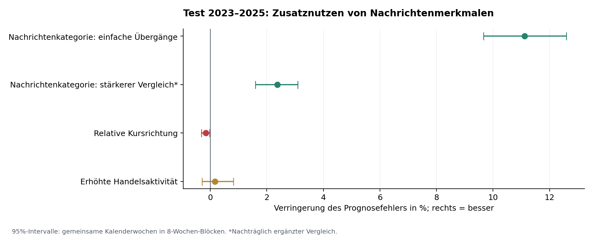
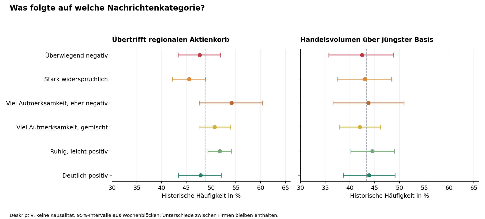

# Stimmung, Erwartungen und Anlegerreaktionen

Internationaler historischer Pilotversuch · 1. November 2026 · Kein Eingriff in die Aktien-App

## Das Ergebnis

Ein statistisches Modell für Nachrichtenstimmung wurde tatsächlich trainiert und außerhalb seiner Lernjahre getestet. Es verbessert die Wahrscheinlichkeitsprognose der nächsten Nachrichtenkategorie. Die zusätzliche Information verbessert in diesem Versuch weder die spätere relative Kursrichtung noch belastbar die Handelsaktivität. Ein rentables Handelssystem oder eine weltweit gültige psychologische Marktregel ist damit nicht nachgewiesen.

Gegenüber einem stärkeren Vergleich, der bereits die aktuelle Kategorie, die Firma und ihre Region kennt, sinkt der Logloss um 2,4 %. Die häufigste prognostizierte Kategorie wird dabei nicht häufiger richtig getroffen: 48,3 % gegenüber 48,5 %. Der Nutzen liegt in der gesamten Wahrscheinlichkeitsverteilung. Dieser stärkere Vergleich wurde nach den drei primären Tests ergänzt; er ist eine zusätzliche Diagnose.

## Daten und tatsächliche Reichweite

Stichprobenrahmen sind sämtliche 100 Unternehmen aus der PwC-Weltrangliste vom 31. März 2018. Damit wurden Unternehmen vor den Lern- und Testjahren gewählt. Diese Auswahl umfasst 19 damalige Unternehmensländer und sechs Regionen. Die Auswahl großer Konzerne ist ausdrücklich kein Modell sämtlicher weltweiter Aktien oder früher Unicorn-Kandidaten.

GDELT GKG 2.1: jeden Mittwoch um 12:00 UTC von Januar 2019 bis Dezember 2025 der englische und der übersetzte Archiv-Stream, 732 angeforderte Dateien. 729 waren verfügbar; eine Übersetzungsdatei vom 13.11.2019 und beide Dateien vom 22.03.2023 fehlten. Die Messung dieser beiden Wochen wird als unvollständig markiert. Es handelt sich um eine feste 15-Minuten-Stichprobe pro Woche. Häufigkeit ist Aufmerksamkeit innerhalb dieser Stichprobe, kein vollständiges weltweites Nachrichtenvolumen.

86,001 unterschiedliche URLs ergeben 101,885 Firma-Artikel-Verknüpfungen in 62 Sprachcodes; 90 der 100 Firmen haben überhaupt einen Treffer. Nachrichten mit mehreren Firmen zählen bei jeder erwähnten Firma. Syndizierte Meldungen mit verschiedenen URLs können weiterhin mehrfach auftreten. Das Auswahl- und Timing-Schema ist unabhängig von späteren Renditen.

Der Ton ist der lexikalische Ton des ganzen Artikels. Ein beiläufig erwähnter Firmenname, eine Übersetzung oder ein politisches Ereignis kann die Zuordnung verzerren. Es wurden keine historischen Texte mit einem heutigen, möglicherweise über spätere Kurse informierten Sprachmodell nachbewertet. Ein URL-Hinweis auf das Unternehmen dient als zusätzlicher, unvollkommener Fokus-Indikator; er ersetzt keine manuell validierte firmenspezifische Sentimentanalyse.

| Region | Firmen im Rahmen | Länder | Zustands-Testfälle mit Folgemessung |
| --- | --- | --- | --- |
| Africa | 1 | 1 | 0 |
| Asia | 17 | 5 | 279 |
| Europe | 23 | 9 | 369 |
| Latin America | 1 | 1 | 0 |
| North America | 56 | 2 | 1983 |
| Oceania | 2 | 1 | 0 |

Der bedingte Stimmungs-Test umfasst letztlich 2.631 Firmenwochen von 50 Unternehmen in 13 Ländern; rund 75 % seiner Beobachtungen kommen aus Nordamerika. In Europa verbessert sich der stärkere Vergleich nicht: Logloss 1,539 beim Vergleich, 1,547 beim Nachrichtenmodell. Asien enthält in diesem Test nur vier Firmen. Für Afrika, Lateinamerika und Ozeanien gibt es keine ausreichend dichten Zustandsfolgen. Das Gesamtergebnis ist daher keine regionale Validierung für die ganze Welt.

## Die sechs aus den Lerndaten gebildeten Kategorien

KMeans mit vorab festgelegten sechs Clustern wurde ausschließlich auf Nachrichten aus 2019–2021 angepasst. Merkmale: mittlerer Wortton, positive plus negative Wortanteile, Streuung des Tons, logarithmierte Zahl der Meldungen und Quellen. Die Namen wurden aus den Zentren abgeleitet; spätere Kursverläufe bestimmen weder Zuordnung noch Namen. Eine Kategorie benötigt mindestens zwei verschiedene URLs aus zwei Quellen und vollständige Archiv-Streams.

| ID | Kategorie | Mittlerer Wortton | Streuung | Meldungen am Clusterzentrum* |
| --- | --- | --- | --- | --- |
| 0 | Überwiegend negativ | -1,99 | 1,73 | 3,5 |
| 1 | Stark widersprüchlich | -1,09 | 4,61 | 4,3 |
| 2 | Viel Aufmerksamkeit, eher negativ | -0,89 | 3,08 | 56,1 |
| 3 | Viel Aufmerksamkeit, gemischt | 0,27 | 2,49 | 11,8 |
| 4 | Ruhig, leicht positiv | 0,61 | 1,17 | 3,2 |
| 5 | Deutlich positiv | 2,09 | 2,35 | 3,4 |

*Rücktransformierter logarithmischer Mittelpunkt, keine durchschnittliche Gesamtzahl aller Nachrichten. „Zu wenig Daten“ erhält ID −1 und keine neutrale/positive Wertung. Nur 9.375 der 36.600 möglichen Firmenwochen haben hinreichende Nachrichten. Im Kurs-Test sind etwa 75 % der aktuellen Zustände unbekannt. „Panik“ und „Euphorie“ bleiben psychologische Hypothesen; diese Wörter werden nicht als gemessene Anlegerzustände ausgegeben.

Die Richtung kann ergänzend „aufhellend“, „stabil“ oder „eintrübend“ heißen. Als beschreibende Schwellen dienen das 25. und 75. Perzentil der Tonänderung in den Lerndaten: -1,25 und 1,22. Das Modell verwendet die kontinuierliche Änderung. Ein positiver Ton allein belegt weder Euphorie noch einen günstigen Einstiegspreis.

## Modell und zeitliche Prüfung

Drei getrennte Aufgaben: (1) die Kategorie der folgenden frischen Wochen-Stichprobe, (2) die Aktienrendite der folgenden Handelswoche relativ zu ihrem Vergleichskorb, (3) ein durchschnittliches Handelsvolumen der Folgewoche über dem zuvor beobachteten 20-Tage-Mittel. Aktuelle und folgende Zustandsziele teilen keine Artikel; rollende Vierwochenmerkmale sind ausschließlich Eingaben.

Alle Kandidaten sind regularisierte logistische Regressionen mit festem C=1. Kurskontrollen: vergangene 5/20/60-Handelstage-Renditen, 20/60-Tage-Volatilität, jüngstes relatives Volumen, Firma und Region. Das kombinierte Modell erhält zusätzlich Nachrichtenmerkmale, deren Änderung und die aktuelle Kategorie. Modelle und Cluster werden auf 2019–2021 trainiert. 2022 ist ein reines Diagnosejahr. Der Test 2023–2025 beginnt am 18.01.2023 und endet mit dem Archivstichtag 17.12.2025; die Grenzbereiche wurden mit mindestens zwei Wochen Abstand ausgespart. Es gab keine Modellsuche oder Anpassung anhand der Validierungs- oder Testkennzahlen.

Kursmerkmale enden spätestens am Dienstag vor dem Archivmittwoch. Für Reaktionsziele gilt der erste lokale Handelstag ab dem folgenden Montag, mindestens fünf Kalendertage später. Kursrenditen laufen vom adjustierten Eröffnungskurs bis zum entsprechenden Eröffnungskurs der nächsten Woche. Der Puffer vermeidet unrealistische unmittelbare Ausführung und testet zugleich nur verzögerte Reaktionen. Ein mögliches Signal innerhalb der ersten Stunden wird damit nicht geprüft.

Benchmark für relative Rendite ist ein gleichgewichteter USD-Korb der zeitgleich verfügbaren Firmen derselben Region. Bei weniger als fünf Firmen wird der globale historische Korb verwendet. Devisen beruhen auf dem letzten verfügbaren Schluss vor der lokalen Handelssitzung; das ist eine Näherung. Der Korb ist ein statistischer Vergleich, kein MSCI World und kein vollständig handelbarer Index. ADRe und unterschiedliche Aktiengattungen begrenzen die Vergleichbarkeit des Volumens. Für historische Abspaltungen wurden keine heutigen Nachfolger unbesehen fortgeführt: DowDuPont endet Mai 2019, United Technologies April 2020.

## Testresultate und Unsicherheit

| Primäre Aufgabe | Testfälle | Fehlermaß (kleiner besser) | Vergleich | Nachrichtenmodell | p, Holm-korrigiert |
| --- | --- | --- | --- | --- | --- |
| Nächste Nachrichtenkategorie | 2631 | logloss | 1,448561 | 1,287501 | 0,0006 |
| Relative Kursrichtung | 14898 | brier | 0,252922 | 0,253319 | 0,9776 |
| Erhöhte Handelsaktivität | 14984 | brier | 0,235334 | 0,234942 | 0,5255 |

Die primäre Stimmungs-Baseline lernt Übergangshäufigkeiten zwischen den sechs Zuständen. Die Kurs- und Aktivitäts-Baselines kennen bereits die genannten Preis-/Volumenmerkmale. Eine konstante, nur im Training geschätzte Ereignishäufigkeit erreicht beim Kursziel sogar einen besseren Brier-Fehler (0,249851) als beide komplexeren Modelle. Die Modelle liefern hier keinen belastbaren Vorteil bei der Aktienauswahl.

| Zusätzlicher Vergleich | Basis | Nachrichtenmodell | 95%-Intervall der Fehlerverringerung |
| --- | --- | --- | --- |
| Stimmung: aktuelle Kategorie + Firma + Region | 1,318796 | 1,287501 | 0,021041 bis 0,040835 |
| Nächste Kategorie inkl. fehlender Messung | 1,358703 | 1,313011 | 0,033355 bis 0,058119 |

Diese beiden Zusatzdiagnosen wurden nach Sichtung der primären Ergebnisse ergänzt; das getestete Nachrichtenmodell und seine Kursmodelle wurden dafür nicht nachjustiert. Für den zweiten Vergleich wird ein separater Verfügbarkeitskopf nur auf den Lernjahren trainiert. Er verteilt die Wahrscheinlichkeit zunächst auf „nächste Woche messbar“ und „nicht messbar“, danach auf die sechs Kategorien. So wird die Auswertung nicht auf nachträglich bekannte Folgeberichterstattung beschränkt: 3.713 zum Prognosezeitpunkt messbare Firmenwochen, davon nur 70,9 % auch nächste Woche messbar. Der Logloss verbessert sich hier um 3,4 %; ein Teil des Gewinns betrifft die Vorhersage der Datenverfügbarkeit. Dies ist keine zusätzliche Messung menschlicher Emotionen.

Konfidenzintervalle und einseitige Nutzen-Tests: 5.000 gepaarte zirkuläre Block-Bootstrap-Wiederholungen über ganze Kalenderwochen in Achtwochenblöcken; alle Firmen einer Woche bleiben zusammen. Sensitivitäten mit vier und 13 Wochen ändern das qualitative Ergebnis nicht. Die drei primären Vergleiche wurden mit Holm korrigiert. Bei konservativer gemeinsamer Korrektur über alle fünf Vergleiche bleibt der zusätzliche gemeinsame Nachrichten-/Verfügbarkeitsvergleich unter p=0,0011. Bootstrap und Korrektur beheben weder schlechte Messung noch alle möglichen langfristigen Abhängigkeiten.

| Kurs-/Aktivitätsaufgabe | AUC Vergleich | AUC Nachrichtenmodell |
| --- | --- | --- |
| Relative Kursrichtung | 0,5012 | 0,4998 |
| Handelsaktivität | 0,6208 | 0,6230 |

AUC 0,5 entspricht keiner besseren Rangordnung als Zufall. Die Kurs-AUC des kombinierten Modells liegt bei 0,4998. Der Aktivitätswert steigt von 0,6208 auf 0,6230; das 95%-Intervall der Brier-Verbesserung schließt Null ein. Das ist kein gesicherter zusätzlicher Nachrichten-Effekt. Auch die Untergruppe mit ausreichenden aktuellen Nachrichten und die URL-Fokus-Untergruppe liefern keinen besseren Brier-Fehler als das Kursmodell. Lokale statt USD-Renditen ändern das negative Kursfazit nicht.

## Welche Reaktionen waren in den Kategorien häufiger?

| Aktuelle Kategorie | Kursfälle | Übertrifft Korb, 95%-Intervall | Volumen erhöht, 95%-Intervall |
| --- | --- | --- | --- |
| Überwiegend negativ | 434 | 47,7 % [43,3 %; 51,9 %] | 42,4 % [35,7 %; 48,8 %] |
| Stark widersprüchlich | 496 | 45,6 % [42,2 %; 48,9 %] | 43,0 % [37,6 %; 48,4 %] |
| Viel Aufmerksamkeit, eher negativ | 231 | 54,1 % [47,6 %; 60,3 %] | 43,7 % [36,6 %; 50,9 %] |
| Viel Aufmerksamkeit, gemischt | 921 | 50,7 % [47,6 %; 53,9 %] | 42,0 % [37,9 %; 46,2 %] |
| Ruhig, leicht positiv | 904 | 51,8 % [49,4 %; 54,1 %] | 44,5 % [40,2 %; 49,0 %] |
| Deutlich positiv | 712 | 47,9 % [43,4 %; 52,1 %] | 43,9 % [38,7 %; 49,1 %] |

Diese Häufigkeiten sind deskriptiv und hängen auch von Firmen, Regionen, Marktphasen und Stichprobenabdeckung ab. Sie zeigen keine durch die Kategorie verursachte Handlung. Jeder abgeschlossene Handel hat Käufer und Verkäufer; mit Tageskursen und Gesamtvolumen lassen sich „die Anleger kaufen/verkaufen“ oder deren Motive nicht direkt identifizieren. Aggressor-seitiger Orderfluss, Depotumschichtungen und Fondsflüsse wurden nicht beobachtet. Ein Kursanstieg ist eine Marktreaktion, kein Nachweis einer bestimmten Emotion.

## Konzept für eine belastbarere weltweite Fassung

Sinnvoll ist ein mehrstufiges Wahrscheinlichkeitsmodell: firmenspezifische Textaussagen und deren Neuigkeit → latenter Zustand aus Ton, Aufmerksamkeit, Widersprüchlichkeit und Überraschung → Verteilung der nächsten Zustände → beobachtbare Marktreaktionen, bedingt auf Bewertung, Erwartungen, Liquidität und Marktregime. Entscheidend ist die Abweichung von dem, was bereits erwartet und eingepreist war. Die hier implementierten Cluster und regulierten Prognoseköpfe sind eine einfache überprüfbare Ausgangsversion dieses Konzepts.

Für die nächste Datenstufe fehlen ein vollständiger historischer Nachrichtenstrom mit damaliger Erstverfügbarkeit, verlässliche Entitätsverknüpfungen, finanzspezifische und sprachlich validierte Sentimentwerte, zeitgestempelte Konsenserwartungen sowie tatsächliche Order-/Kapitalflussdaten. Auch delistete Firmen, kleinere Aktien, historische Aktiengattungen und regionale Anlegergruppen müssten im Point-in-time-Universum enthalten sein. Danach wären ein vorab festgelegter geografischer Test und ein neuer prospektiver Zeitabschnitt nötig. Solche Daten wurden hier nicht durch synthetische Beobachtungen ersetzt.

Als konkretes Ausgabeformat erhält eine Aktie: aktuelle Kategorie oder „zu wenig Daten“, Datenabdeckung, Wahrscheinlichkeiten der sechs nächsten Kategorien plus fehlender Messbarkeit, Wahrscheinlichkeit relativer Kursstärke und erhöhten Handelsvolumens sowie eine knappe Erklärung der wichtigsten beobachteten Merkmale. Farben dienen der Darstellung des Tons bzw. der Unsicherheit; sie begründen in diesem Versuch keine Kaufempfehlung. Die App wurde nicht verändert.

## Literatur und Grenzen der Schlussfolgerung

Fraiberger, Lee, Puy und Ranciere untersuchen in „Media Sentiment and International Asset Prices“ (IMF WP/18/274; publizierte Fassung 2021) mehrjährige Reuters-Nachrichten und internationale Aktien-/Kapitalflussdaten. Ihre Ergebnisse motivieren insbesondere die Trennung lokaler und globaler Stimmung und verschiedener Zeithorizonte. Eine solche Studie kann die Hypothese stützen; sie validiert weder unsere gemessenen Kategorien noch die Wirtschaftlichkeit dieses Modells. Unser Wochen-Sampling und der mehrtägige Puffer sind wesentlich gröber.

Die Daten wurden 2026 rückblickend geladen. Archivdatum und konservative Zeitgrenzen reduzieren Look-ahead-Risiken, belegen aber keine lückenlose unveränderte Originalversion jeder Quelldatei. Yahoo-Kurse sind aktuell adjustierte Forschungsdaten mit möglichen Revisionen, Abspaltungs- und Delisting-Problemen. Die historische Liste vermeidet die Auswahl nur heutiger Gewinner, bleibt jedoch eine vorselektierte große und liquide Unternehmenskohorte. Eine vollständig biasfreie Validierung ist damit nicht möglich. Es wurde kein Portfolio nach Transaktionskosten, Geld-/Briefkursen, Steuern oder Markteinfluss getestet; aus diesen Prognosemaßen folgt keine Netto-Überrendite.

Zwölf automatisierte Integritätsprüfungen bestanden, darunter zeitliche Reihenfolge, eindeutige Firmenwochen, frische Zustandsziele, Wahrscheinlichkeitsnormierung und unveränderte Protokoll-/Modellquellen seit dem letzten Lock vor dem ersten Zieltest. Zwei Wochenrenditen über 50 % wurden als Ausreißer dokumentiert und nicht nachträglich entfernt. Diese Prüfungen kontrollieren die Implementierung, nicht die Wahrheit einer psychologischen Interpretation.

## Quellen und Reproduktion

Das Paket enthält die verwendeten kompakten Nachrichtenmetadaten, Kurs-/Devisen-Snapshots, archivierte Modellvorhersagen, Modelle, Protokoll, Prüfergebnisse und Python-Skripte. Aufrufe und Paketversionen stehen in README.md. sources.md dokumentiert die Herkunft; archive_manifest.json und prices_manifest.json dokumentieren Abdeckung und Hashes. Die primäre Konfiguration ist zeitlich vor dem ersten Modelltest protokolliert; die zusätzlichen Diagnosen sind ausdrücklich nachträglich gekennzeichnet.

- [PwC, Global Top 100, März 2018](https://preview.thenewsmarket.com/Previews/PWC/DocumentAssets/514404.pdf)

- [GDELT GKG 2.1 Codebook](https://data.gdeltproject.org/documentation/GDELT-Global_Knowledge_Graph_Codebook-V2.1.pdf)

- [GDELT 2.0 und mehrsprachige Archive](https://blog.gdeltproject.org/gdelt-2-0-our-global-world-in-realtime/)

- [Fraiberger et al., IMF WP/18/274](https://www.imf.org/en/publications/wp/issues/2018/12/10/media-sentiment-and-international-asset-prices-46454)

- [Roche, ROG/ROP-Austausch](https://www.roche.com/investors/updates/inv-update-2026-03-16)