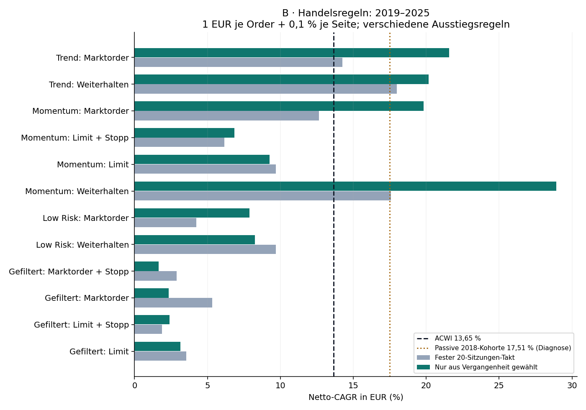
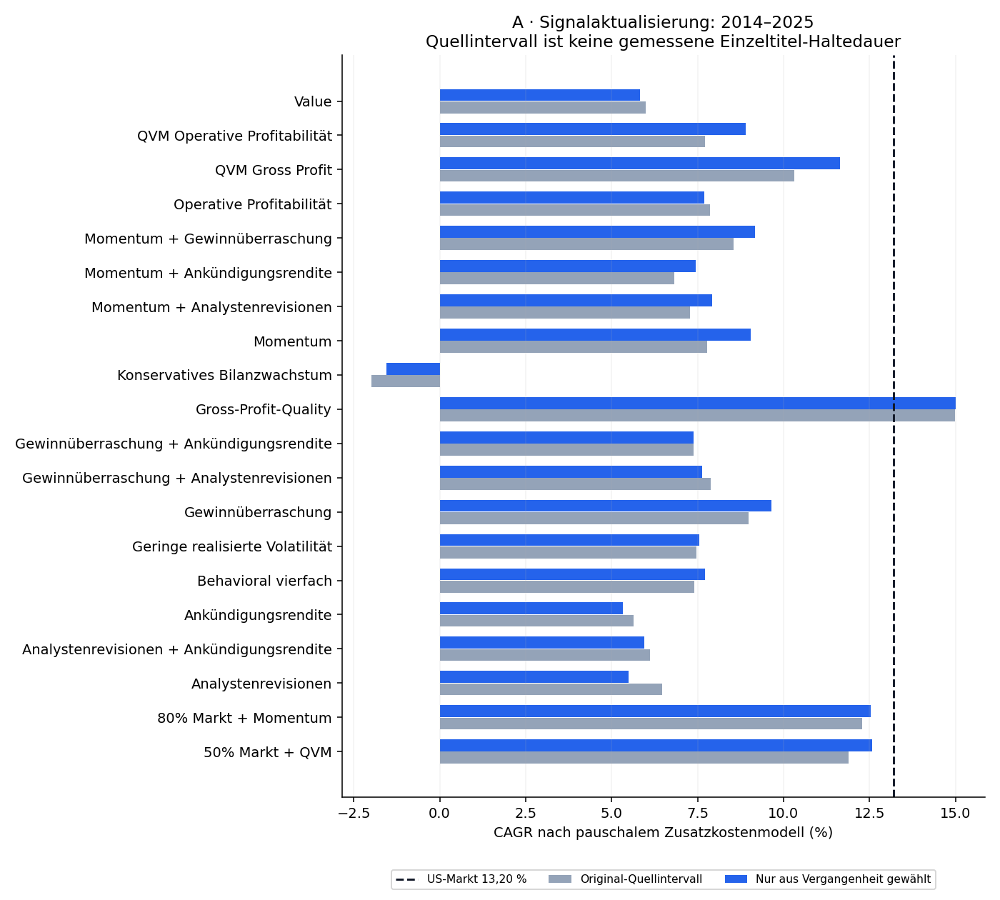
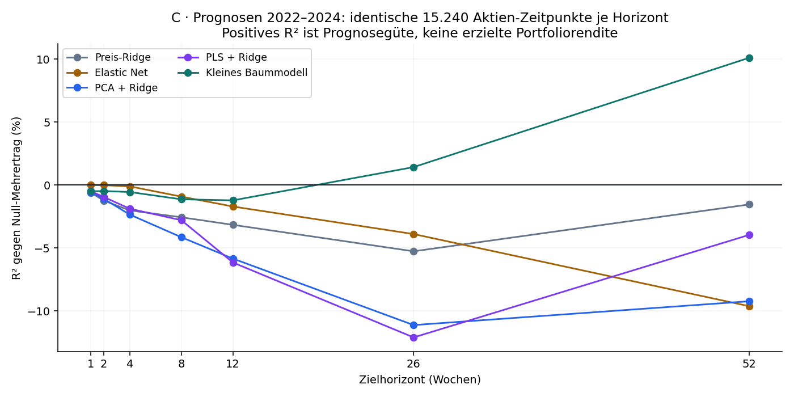

# Haltedauer und Prognosehorizont: abgeschlossene Folgestudie

02.11.2026 · explorative historische Forschung · App unverändert · Vollständige Parameter, Eingaben, Ergebnisse und Korrekturhistorie archiviert.

## Die Antwort auf deinen Einwand

Ja: Die Ergebnisse hängen erheblich von Haltedauer, Signalprüfung und Ausstiegsregel ab. Die frühere pauschale Interpretation negativer Kurzfristtests war zu weitgehend. In dieser Folgestudie verbessern längere Intervalle einige Handelsregeln deutlich; andere werden schlechter. Ein universelles oder künftig garantiert optimales Halteintervall ist damit nicht gefunden.

Die Dauer wird jedes Jahr ausschließlich aus den vorher abgeschlossenen Daten gewählt. Keine Ergebniszeile wird mit der nachträglich besten Dauer des gesamten Testzeitraums als handelbare Zukunftsprognose ausgegeben. Frühere Ergebnisse und historische Jahre waren bereits bekannt: dies ist keine neue unberührte Bestätigung.

| Teil | Umfang | Bewertung | Bedeutung |
| --- | --- | --- | --- |
| A: Literaturfaktoren | 20 Strategien/Mischungen; 1/3/6/12 Monate | 2014–2025 | Aktualisierungsintervall; keine harte Einzeltitel-Frist |
| B: Handelsregeln | 12 Politiken; 5/10/20/60/120/252 Sitzungen | 2019–2025 | Endlicher Ausstieg vs. Weiterhalten getrennt |
| C: Prognosemodelle | 5 Modelle; 1/2/4/8/12/26/52 Wochen | 2022–2024 | Neu gelernte Zielhorizonte; keine ausgeführte Handelsstrategie |

## B: Der größte Unterschied liegt bei den Handelsregeln

Historische, im März 2018 festgelegte PwC-Großkonzern-Kohorte; ab 2019 bewertete Entscheidungen. Die vergangenheitsbasierte Dauerwahl nutzt jeweils die letzten fünf Kalenderjahre und den Netto-Information-Ratio gegenüber ACWI. 10.000 EUR Anfangskapital, 1 EUR pro tatsächlichem Kauf/Verkauf und 0,1 % ungünstige Ausführung pro Seite. Maximal zehn Aktien und vier je Region werden auch beim tatsächlichen Kauf erzwungen.

| Strategie | 20-Takt CAGR % | Gewählter Takt CAGR % | Max. Drawdown % | Median Haltedauer¹ | Größte Position² % | p Holm³ |
| --- | --- | --- | --- | --- | --- | --- |
| Momentum: Marktorder | 12,65 | 19,82 | -28,74 | 252 | 20,13 | 0.2957 |
| Momentum: Limit | 9,68 | 9,27 | -18,95 | 20 | 14,91 | 1.0000 |
| Momentum: Limit + Stopp | 6,15 | 6,86 | -17,20 | 9 | 16,52 | 1.0000 |
| Gefiltert: Marktorder | 5,33 | 2,33 | -17,83 | 20 | 14,50 | 1.0000 |
| Gefiltert: Limit | 3,54 | 3,14 | -13,30 | 10 | 13,82 | 1.0000 |
| Gefiltert: Marktorder + Stopp | 2,89 | 1,64 | -16,96 | 17.5 | 14,19 | 1.0000 |
| Gefiltert: Limit + Stopp | 1,87 | 2,40 | -10,99 | 9 | 16,06 | 1.0000 |
| Low Risk: Marktorder | 4,24 | 7,88 | -27,21 | 120 | 19,59 | 0.0310 |
| Trend: Marktorder | 14,25 | 21,57 | -28,61 | 120 | 15,99 | 0.0064 |
| Momentum: Weiterhalten | 17,60 | 28,91 | -31,31 | 252 | 61,20 | 0.2759 |
| Low Risk: Weiterhalten | 9,69 | 8,26 | -27,03 | 47.5 | 17,04 | 1.0000 |
| Trend: Weiterhalten | 17,98 | 20,16 | -28,52 | 120 | 21,29 | 1.0000 |

¹ Tatsächlich abgeschlossene Trades, ACWI-/US-Sitzungen einschließlich Kauftag. Noch offene Positionen sind zensiert und gehen nicht als abgeschlossene Trades ein. Bei Weiterhalten darf die Dauer größer als das Prüfintervall sein. ² Größtes beobachtetes Gewicht einer Einzelaktie am Tagesende. ³ Test des zusätzlichen mittleren Renditebeitrags gegenüber derselben Regel bei festem 20-Takt; nicht Test einer gesicherten Marktüberlegenheit. Einseitiger Zeitblock-Bootstrap, gemeinsam über 32 primäre Strategievergleiche mit Holm korrigiert.

Passives ACWI erreicht mit demselben EUR-/Einstiegskostenmodell 13,65 % CAGR. Die zusätzlich nach den primären Ergebnissen berechnete passive Gleichgewichtung der anfänglich handelbaren 99 Aktien derselben historischen Kohorte erreicht 17,51 %. Diese Diagnose zeigt die Bedeutung des Universums; sie ist wegen anderer Streuung und fehlender Zehn-Aktien-Grenze kein identisches Risikoprofil.

Momentum mit Weiterhalten erreicht 28,91 % CAGR, hat aber zeitweise 61,20 % in einer Aktie und rund 31,31 % maximalen Drawdown. Das ist ein erheblicher Konzentrationseffekt. Weiterhalten verändert nicht nur Gebühren, sondern auch Gewichte und Exposition. Die Differenz zum erzwungenen Verkauf ist deshalb keine reine Verbesserung der Kursprognose.

Nach gemeinsamer Korrektur verbessert die Dauerwahl Trend-Marktorder gegenüber 20 Sitzungen (p = 0,0064) und Low-Risk-Marktorder (p = 0,0310). Low Risk bleibt trotz dieser Verbesserung unter ACWI. Die großen Momentum-Zuwächse sind in diesem primären Test nicht statistisch gesichert. Wenige lange Marktabschnitte, bekannte Testjahre, Auswahl derselben Strategieideen in früheren Untersuchungen und ungefähre globale Ausführungen begrenzen auch die kleinen p-Werte.

### Welche Intervalle wurden tatsächlich aus der Vergangenheit gewählt?

| Regel | Gewählte Sitzungen: Anzahl der sieben Testjahre |
| --- | --- |
| Momentum: Marktorder | 120: 1 J.; 252: 6 J. |
| Momentum: Limit | 20: 2 J.; 60: 1 J.; 120: 2 J.; 252: 2 J. |
| Momentum: Limit + Stopp | 10: 2 J.; 20: 2 J.; 60: 2 J.; 252: 1 J. |
| Gefiltert: Marktorder | 10: 1 J.; 20: 3 J.; 60: 2 J.; 120: 1 J. |
| Gefiltert: Limit | 10: 2 J.; 20: 2 J.; 60: 2 J.; 120: 1 J. |
| Gefiltert: Marktorder + Stopp | 20: 1 J.; 120: 2 J.; 252: 4 J. |
| Gefiltert: Limit + Stopp | 10: 2 J.; 20: 2 J.; 60: 1 J.; 120: 1 J.; 252: 1 J. |
| Low Risk: Marktorder | 60: 1 J.; 120: 1 J.; 252: 5 J. |
| Trend: Marktorder | 60: 2 J.; 120: 5 J. |
| Momentum: Weiterhalten | 20: 1 J.; 120: 1 J.; 252: 5 J. |
| Low Risk: Weiterhalten | 5: 2 J.; 10: 1 J.; 60: 1 J.; 120: 1 J.; 252: 2 J. |
| Trend: Weiterhalten | 20: 1 J.; 60: 2 J.; 120: 4 J. |

Beispiel Momentum-Marktorder: 2019 252, 2020 120, 2021–2025 jeweils 252 Sitzungen. Trend-Marktorder: meist 120, 2021 und 2025 60 Sitzungen. Dies sind rückblickend dokumentierte Entscheidungen eines vorher festgelegten Auswahlverfahrens, keine sichere heutige Kauf-/Verkaufsfrist.

### Vollständiges festes Raster ohne nachträgliche Gewinnerempfehlung

| Regel | 5 | 10 | 20 | 60 | 120 | 252 |
| --- | --- | --- | --- | --- | --- | --- |
| Gefiltert: Limit | 0,75 | 3,72 | 3,54 | 1,45 | 1,95 | -1,33 |
| Gefiltert: Limit + Stopp | -0,13 | 3,09 | 1,87 | -0,68 | -0,85 | -1,13 |
| Gefiltert: Marktorder | -5,25 | 4,11 | 5,33 | 5,68 | 6,54 | 2,43 |
| Gefiltert: Marktorder + Stopp | -6,75 | 2,51 | 2,89 | 2,32 | 2,87 | 3,53 |
| Low Risk: Weiterhalten | 9,69 | 9,92 | 9,69 | 10,19 | 10,64 | 10,10 |
| Low Risk: Marktorder | -17,06 | -1,42 | 4,24 | 10,22 | 9,92 | 10,40 |
| Momentum: Weiterhalten | 20,04 | 22,08 | 17,60 | 18,17 | 18,02 | 23,94 |
| Momentum: Limit | 1,30 | 10,72 | 9,68 | 10,53 | 6,48 | 13,10 |
| Momentum: Limit + Stopp | -1,01 | 6,87 | 6,15 | 2,60 | 2,06 | 0,43 |
| Momentum: Marktorder | -2,04 | 11,94 | 12,65 | 17,75 | 17,63 | 25,05 |
| Trend: Weiterhalten | 14,57 | 16,21 | 17,98 | 19,44 | 23,80 | 14,46 |
| Trend: Marktorder | -8,76 | 7,15 | 14,25 | 19,86 | 22,78 | 14,83 |

## A: Literaturfaktoren brauchen unterschiedliche Aktualisierungsintervalle

OpenSourceAP HoldPer 1/3/6/12 verändert laut Quellcode die Monate, in denen Portfoliozuordnungen aktualisiert und dazwischen fortgeschrieben werden. Es ist keine gemessene durchschnittliche Haltedauer und erzwingt keinen Verkauf jeder Aktie nach K Monaten. Das Quellportfolio gewichtet weiterhin nach seinen Regeln. Die jährliche Auswahl nutzt 120 vorangegangene vollständig bekannte Monatsrenditen; Zusatzkosten pauschal 1 % pro Jahr auf den aktiven Anteil, mit 0/2-%-Sensitivität, nicht genaue Einzelorderkosten.

| Faktor/Mischung | Original CAGR % | Gewählt CAGR % | Drawdown % | Monate: Anzahl Jahre |
| --- | --- | --- | --- | --- |
| Momentum | 7,78 | 9,04 | -36,68 | 1: 12 J. |
| Value | 5,99 | 5,82 | -73,85 | 1: 4 J.; 6: 6 J.; 12: 2 J. |
| Gross-Profit-Quality | 14,99 | 15,01 | -31,44 | 1: 3 J.; 12: 9 J. |
| Konservatives Bilanzwachstum | -1,99 | -1,54 | -60,27 | 1: 10 J.; 6: 1 J.; 12: 1 J. |
| Operative Profitabilität | 7,86 | 7,69 | -36,24 | 1: 7 J.; 12: 5 J. |
| Geringe realisierte Volatilität | 7,47 | 7,56 | -16,86 | 1: 1 J.; 3: 11 J. |
| Gewinnüberraschung | 8,99 | 9,64 | -31,93 | 1: 1 J.; 3: 2 J.; 6: 9 J. |
| Analystenrevisionen | 6,48 | 5,50 | -45,51 | 1: 4 J.; 12: 8 J. |
| Ankündigungsrendite | 5,65 | 5,33 | -47,57 | 1: 9 J.; 12: 3 J. |
| Momentum + Gewinnüberraschung | 8,54 | 9,18 | -33,51 | 1: 12 J. |
| Momentum + Analystenrevisionen | 7,28 | 7,92 | -40,57 | 1: 12 J. |
| Momentum + Ankündigungsrendite | 6,82 | 7,45 | -42,18 | 1: 12 J. |
| Gewinnüberraschung + Analystenrevisionen | 7,89 | 7,63 | -38,24 | 1: 8 J.; 12: 4 J. |
| Gewinnüberraschung + Ankündigungsrendite | 7,39 | 7,38 | -36,36 | 1: 10 J.; 6: 2 J. |
| Analystenrevisionen + Ankündigungsrendite | 6,13 | 5,96 | -46,21 | 1: 10 J.; 12: 2 J. |
| Behavioral vierfach | 7,40 | 7,72 | -36,91 | 1: 12 J. |
| QVM Gross Profit | 10,32 | 11,64 | -34,76 | 1: 12 J. |
| QVM Operative Profitabilität | 7,73 | 8,90 | -43,05 | 1: 12 J. |
| 50% Markt + QVM | 11,89 | 12,57 | -24,60 | 1: 12 J. |
| 80% Markt + Momentum | 12,28 | 12,54 | -24,39 | 1: 12 J. |

US-Markt: 13,20 % CAGR 2014–2025. Gross-Profit-Quality erreicht 15,01 % gegenüber 14,99 % beim ursprünglichen Intervall: fast kein zusätzlicher Nutzen der Intervallwahl. Momentum verbessert sich von 7,78 auf 9,04 %, Gewinnüberraschung von 8,99 auf 9,64 %, bleibt aber unter dem Markt. Kein akademischer Intervall-Zusatznutzen besteht den gemeinsamen Holm-Test. Quellgewichte/Quantilzahl unterscheiden sich teilweise vom früheren Primärtest; Unterschiede zu alten Studien sind daher nicht ausschließlich Haltedauer-Effekte.

## C: Längere Ziele ändern den Befund des Prognosemodells

44 historische Preis-, Markt- und Nachrichtenmerkmale; 98 Firmen, 156 wöchentliche Prognosetermine und identische 15.240 Aktien-Zeitpunkte je Horizont. Modelle werden für jeden Horizont neu gelernt. Medianersatz, Begrenzung, Skalierung, PCA/PLS und Parameterwahl verwenden ausschließlich vergangene, vollständig gereifte Trainingsziele einschließlich der regionalen Benchmark. Vorhersagen 2022–2024; 52-Wochen-Ziele reichen ins Jahr 2025. Leere innere Jahresvalidierung bei 52 Wochen verwendet die vorab definierte feste Konfiguration statt einer späteren Optimierung.

| Wochen | Elastic Net | Preis-Ridge | PCA | PLS | Baummodell |
| --- | --- | --- | --- | --- | --- |
| 1 | -0,00 | -0,62 | -0,57 | -0,50 | -0,50 |
| 2 | -0,01 | -1,24 | -1,10 | -0,95 | -0,48 |
| 4 | -0,11 | -2,02 | -2,35 | -1,88 | -0,56 |
| 8 | -0,92 | -2,57 | -4,15 | -2,80 | -1,13 |
| 12 | -1,71 | -3,17 | -5,85 | -6,16 | -1,22 |
| 26 | -3,90 | -5,27 | -11,13 | -12,11 | 1,42 |
| 52 | -9,63 | -1,55 | -9,24 | -3,96 | 10,11 |

Die Tabelle zeigt R² in Prozent gegen eine Prognose von Null-Mehrertrag gegenüber der regionalen Aktienkohorte. 10,11 % R² bedeutet hier 10,11 % weniger quadratischen Prognosefehler als diese Nullreferenz; es bedeutet keine Rendite von 10,11 % und keine garantierte Kursrichtung.

PCA und PLS haben bei keinem geprüften Horizont einen besseren Gesamtfehler als Null-Mehrertrag. Das kleine Baummodell ist bei 26 Wochen mit 1,42 % und bei 52 Wochen mit 10,11 % R² positiv. Der frühere negative Vierwochen-Befund darf daher nicht auf jedes Modell und jeden Horizont verallgemeinert werden.

| Prognosejahr | 26 Wochen R² % | 52 Wochen R² % |
| --- | --- | --- |
| 2022 | -0,96 | 16,34 |
| 2023 | 9,92 | 18,23 |
| 2024 | -5,62 | -6,70 |

| Wochen | Deskriptives 95-%-Intervall unten % | oben % |
| --- | --- | --- |
| 26 | -15,81 | 12,49 |
| 52 | -7,82 | 23,14 |

Die nachträglich ergänzte Unsicherheitsdiagnose resampelt gemeinsam alle Aktien nach Kalenderzeit in 52-Wochen-Blöcken. Beide Intervalle enthalten null; 2024 ist auch das Baummodell negativ. Drei Testjahre und stark überlappende lange Ziele sind sehr wenig unabhängige Evidenz. Kein formaler Siegernachweis unter 35 Modell-Horizont-Paaren, keine kostenbereinigte 52-Wochen-Handelsstrategie, keine Empfehlung des nachträglich besten Paars.

## Was noch nicht beantwortet ist

Die vollständigen individuellen App-Strategien Hoch-Tief-Mut/Sander, Frühwachstum/Multibagger und sämtliche Fundamental-Ampelkombinationen sind ohne historische Filing-, Quartals- und Bewertungsvintages nicht identisch testbar. Literaturfaktoren sind passende Teilproxies, keine vollständige Bestätigung oder Widerlegung dieser App-Regeln. Nachrichten aus historischen Archivsammlungen bleiben ein Quellen- und Abdeckungsmodell, keine allwissende Messung weltweiter Anlegeremotionen.

Aktienuniversum, Firmenereignisse, revidierte/splitbereinigte Preisreihen und 2026 neu berechnete akademische Portfolios verhindern den Anspruch absoluter Biasfreiheit. Das B-Modell nutzt Bruchstücke auf bereinigten Preisen, verzögerte FX-Referenzen, approximative Börsen-/OHLC-Ausführung, keine Steuern oder Zinsen auf Cash, keine abschließende Liquidation offener Positionen. Quellengewichte, Regionen, Währungen und Testjahre unterscheiden sich zwischen A/B/C. Renditen dieser Teile dürfen nicht direkt als faire Rangliste vermischt werden.

## Prüfung und dokumentierte Korrekturen

1211 Integritäts-, Zeitgrenzen- und Reproduktionsprüfungen bestanden. Alle zwölf adaptiven B-Pfade wurden aus dem eingefrorenen Daten-Cache exakt reproduziert. Bei jeder Bewertung wurden tatsächliche Eintritte auf zehn Positionen/vier je Region begrenzt, Cash und gereifte Zielgrößen geprüft. Diese Prüfungen belegen keine perfekte historische Datenvintage.

Vor dem ersten gültigen B-Ergebnis wurden die Finanzierung neuer Käufe aus erst späteren globalen Verkäufen und die Reihenfolge von Intraday-Stopp und Schlussverkauf korrigiert. Nach den ersten Zwischenwerten zeigte die Integritätsprüfung wegen unterschiedlicher Börsenfeiertage zeitweise elf Positionen: Kaufgrenzen wurden beim tatsächlichen Eintritt erzwungen, B vollständig neu gerechnet, alte Fassung und Ergebnisse separat behalten. Keine neue Parameter-, Dauer- oder Modellauswahl aufgrund dieser Ergebnisse. Zusätzliche passive Kohorten-/Unsicherheitsdiagnosen sind ausdrücklich nachträglich und wählen keinen Sieger.

## Wiederverwenden und reproduzieren

Zuerst diese Berichte sowie output/strategy_summary.csv, output/primary_tests_joint.json und die vollständigen Kennzahl-/Entscheidungsdateien lesen; zum Nachsehen keine neue Berechnung starten. protocol.md enthält das vor Auswertung fixierte Protokoll; output/*lock*.json und verification.json identifizieren Code/Daten und Korrekturen. sources/ enthält Originalcode und frühere Fassungen. DATA_MANIFEST.json listet alle verwendeten/mitgelieferten Dateien mit SHA-256; BUNDLE_MEMBERS.json jedes Paketmitglied.

Eine neue Reproduktion nutzt die mitgelieferten kompakten Eingaben statt erneut Kurse/Nachrichten abzurufen: python -m pip install -r requirements.txt; python code/run_academic.py; python code/run_trading.py; python code/run_forecast_horizons.py; python code/summarize_results.py; python code/diagnostics.py; python code/verify.py; python code/make_report.py. Vom entpackten Studienordner aus starten. Laufzeit auf dieser Maschine: B rund 48 Sekunden, C rund 146 Sekunden; Rechner und Bibliotheken können kleine numerische Abweichungen bewirken. Keine Abhängigkeit von einer geöffneten App.

## Quellen und Bezug zu vorherigen Studien

OpenSourceAP/CrossSection, Revision ad1dfba5a6d80c4ce53ce6b8127f5a949dda1e40: https://huggingface.co/datasets/OpenSourceAP/CrossSection/tree/ad1dfba5a6d80c4ce53ce6b8127f5a949dda1e40 . Portfolio-Code: https://github.com/OpenSourceAP/CrossSection/blob/master/Portfolios/Code/01_PortfolioFunction.R sowie 30_PredictorAltPorts.R; genaue heruntergeladene Fassungen unter sources/. Marktinputs: bestehende French-Daten im eingefrorenen Monats-Cache. Globale Aktien-/FX-Quoten: Yahoo Chart, Enddatum im verwendeten Cache strikt 2025-12-31, URLs und Hashes in data/price_manifest.json. Historische Kohorte und 44 Merkmale: vorherige archivierte PCA-/Nachrichtenstudie, unveränderte Identitäten in den kompakten Eingaben und Manifesten.

Frühere Studie: research/tests/2026-11-02-pca-factor-states; frühere akademische/Behavioral- und Handelsregeln siehe Forschungsindex. Jegadeesh & Titman (1993), https://doi.org/10.1111/j.1540-6261.1993.tb04702.x , motiviert mehrere Momentum-Horizonte, bestimmt aber kein heutiges Optimum. Methodik zeitlicher Modellauswahl: https://scikit-learn.org/stable/auto_examples/model_selection/plot_nested_cross_validation_iris.html und https://scikit-learn.org/stable/common_pitfalls.html .
