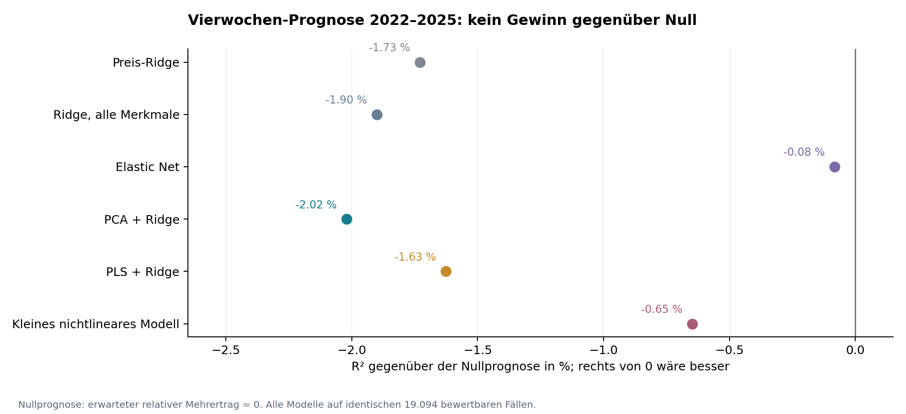
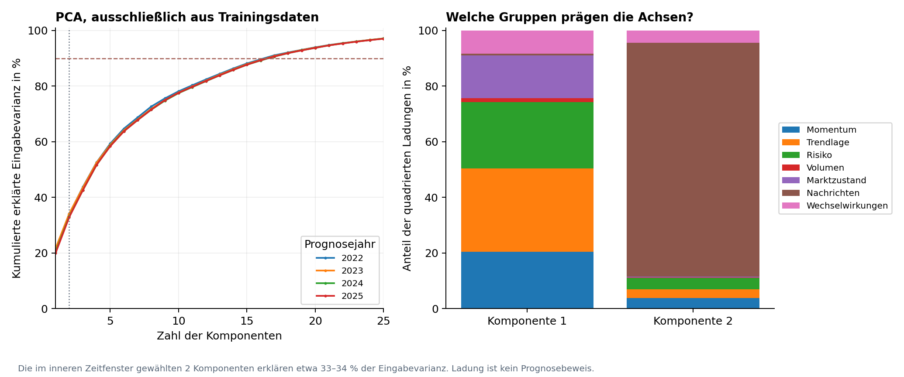
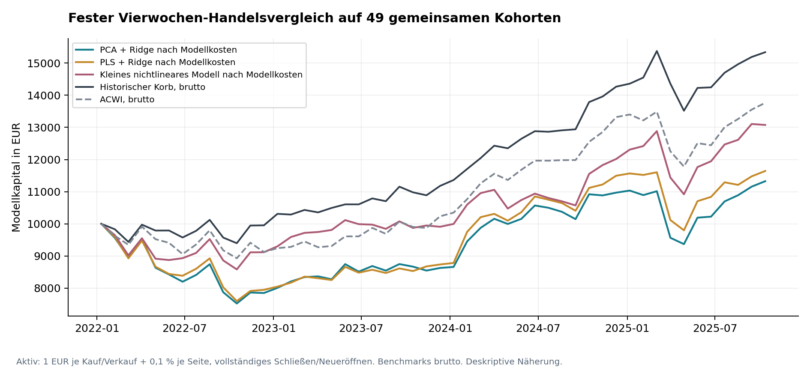

# PCA, Faktor-Zustände und Kursprognosen

Historische Folgestudie · 02.11.2026 · Die Aktien-App wurde nicht verändert.

## Ergebnis

Die vorgeschlagene gemeinsame Faktorenanalyse wurde durchgeführt. PCA, PLS, regularisierte Regressionen und ein kleiner fester nichtlinearer Vergleich wurden zeitlich vorwärts getestet. In diesem Datensatz liefert keines der Modelle einen geringeren mittleren Prognosefehler als die einfache Annahme eines erwarteten Mehrertrags von null. Ein belastbares Modell zur Vorhersage überdurchschnittlicher Kursanstiege wurde nicht gefunden.

Die PCA identifiziert nachvollziehbare gemeinsame Achsen. Das sind Beschreibungen von Variation in den Eingaben; sie sind weder automatisch wesentliche Kursprädiktoren noch Belege psychologischer Ursachen. Das negative Ergebnis betrifft die vorhandenen Merkmale, die historische Großkonzern-Kohorte und die hier untersuchten Vier-/Zwölfwochen-Ziele. Es beweist keine allgemeine Unmöglichkeit von Renditeprognosen.

## Was aus den sieben früheren Testpaketen zusammengeführt werden konnte

| Paket | Gespeicherte Ebene | Verwendung |
| --- | --- | --- |
| Fünfjahres-Backtest | Trades, 320 überlappende Datumstests, Kurven | Kurs-/Volumen-/ATR-Merkmale rekonstruiert; künftige Tradegewinne keine Eingaben |
| ATR-Grenzen | 20 Stop-/Limit-Varianten und Ergebnisse | ATR als damaliger Risikozustand; keine Ergebnisse späterer Ausführungen als Faktor |
| 12–2-Momentum | Strategievergleiche und Kurven | Historisches Momentum als Eingabe, hier exakt zwischen 252 und 42 Handelstagen |
| Wissenschaftliche Faktorstudie | Aggregierte Value-/Quality-/Investment-/Momentum-Portfolios | Marktindikatoren in gesonderter, nicht streng point-in-time-fähiger Erweiterung |
| Unabhängige Handelsregeln | Trades und Variantenkurven | Vergleichs-/Kostenannahmen und Grenzen; keine Vermischung mit Aktienmerkmalen |
| Behavioral-Studie | 312 Monate primitive Signal-/Faktorportfoliorenditen | 24 verzögerte Marktindikatoren im Zusatztest |
| Globales Stimmungsmodell | Historische Nachrichten-Metadaten, Kurse, Devisen | Hauptquelle für gemeinsames Aktien-Zeitpunkt-Panel; frühere Zustands- und Zukunftsspalten ausgeschlossen |

Frühere Handelsgewinne, nachträgliche Stop-Ausgänge oder Testergebnisse lassen sich nicht als damals bekannte Faktoren verwenden. Einige ältere Studien haben heute noch gelistete Firmen rückwirkend untersucht. Dieser Auswahlfehler wird durch PCA nicht behoben; ihre Trade-Ergebnisse werden nicht in das neue Trainingspanel eingespeist.

Das neue Panel verwendet unverändert die vor 2019 veröffentlichte PwC-Top-100-Liste vom März 2018. 34.323 Firmen-Zeitpunkte von 100 Firmen aus 19 Ländern stehen zwischen 02.01.2019 und 24.09.2025 bereit. Daraus entstehen 19.108 Vorwärtsprognosen für 98 Firmen und 195 Testwochen; 19.094 haben eine bewertbare Vierwochen-Zielrendite. Zwei historische Unternehmensreihen enden bei ihren strukturellen Abspaltungen; über diese Grenze hinaus wird keine Nachfolgerhistorie unterstellt.

44 numerische Hauptmerkmale: 18 technische Merkmale, vier Marktmerkmale, 16 Nachrichtenmerkmale und sechs festgelegte Wechselwirkungen. Firmen-/Regionskontrollen und fehlende Werte werden separat berücksichtigt. Vollständige historische firmenspezifische Bewertungs-, Bilanz-, Gewinnüberraschungs- und Analystenkonsens-Vintages fehlen. Eine heutige Kennzahl wurde nicht in die Vergangenheit kopiert. Der Versuch ist daher keine vollständige Prüfung aller jemals in der App diskutierten Fundamentalaspekte.

## Ziel und zeitliche Durchführung

Primär vorhergesagt wird die Vierwochen-Rendite einer Aktie relativ zum zeitgleichen gleichgewichteten regionalen Aktienkorb in USD. Bei Regionen mit weniger als fünf Titeln gilt der historische globale Korb. Sekundär wird dasselbe Zwölfwochen-Ziel geprüft. Das unterscheidet Aktienauswahl mit Mehrertrag von der bloßen Vorhersage eines allgemeinen Kursanstiegs in einem steigenden Markt.

Die Eingabe entspricht einem Archivmittwoch um 12:00 UTC. Alle technischen Kursmerkmale enden am vorangegangenen Dienstag. Einstieg ist frühestens der folgende Montag; Ausstieg vier bzw. zwölf Kalenderwochen später, jeweils der erste verfügbare lokale Handelstag innerhalb von vier Tagen. Die mehrtägige Verzögerung ist konservativ und prüft keine unmittelbare Intraday-Reaktion auf Meldungen.

Für jedes Prognosejahr 2022, 2023, 2024 und 2025 wird das Modell neu mit expandierender Vergangenheit ab 2019 geschätzt. Nur bereits vor dem Jahreswechsel abgeschlossene Zielrenditen werden trainiert. Das gilt auch für alle Bestandteile der zugehörigen Benchmarkrendite. Die Parameterwahl erfolgt innerhalb dieses Trainingsbereichs im letzten abgeschlossenen Kalenderjahr; die davorliegenden Jahre liefern das innere Training. Kein zufälliges Zeilensplitting.

Median-Ersetzung, Begrenzung auf Trainings-Perzentile 1/99, Standardisierung, Firmenkodierung und PCA/PLS werden pro Fenster neu nur aus Trainingsdaten gelernt. Die früher auf 2019–2021 geschätzten Stimmungskategorien werden nicht als Eingaben wiederverwendet. Nachrichten-Rohmerkmale und ihre rückwärts gerichteten Änderungen bleiben erhalten. Imputed Werte sind Rechenhilfen, keine behaupteten neutralen Stimmungen.

Die Protokoll- und Quellcode-Hashes wurden vor Berechnung der neuen Zielkennzahlen festgehalten. Die früheren Studienergebnisse waren jedoch bereits bekannt. Dies ist daher eine explorative historische Folgestudie und keine neue intellektuell unberührte Bestätigung. Ein möglicher Erfolg hätte einen separat festgelegten oder prospektiven Prüfzeitraum gebraucht.

## Verglichene Modelle

| Modell | Vorab festgelegte Auswahl |
| --- | --- |
| Nullprognose | Erwarteter relativer Mehrertrag = 0 |
| Preis-Ridge | Preis-/Volumen-/Marktzustände inkl. rein kursbasierter Wechselwirkungen; Ridge α 1/10/100 |
| Ridge, alle Merkmale | Alle 44 Merkmale, Ridge α 1/10/100 |
| Elastic Net | Alle Merkmale, l1_ratio 0,5; α 0,0001/0,001/0,01 |
| PCA + Ridge | 2/4/8/12/20 numerische PCA-Komponenten, danach Ridge α 10 plus Kontrollen |
| PLS + Ridge | 2/4/8/12 überwachte PLS-Komponenten, danach Ridge α 10 plus Kontrollen |
| Kleines nichtlineares Modell | Ein fester kleiner Baumensemble-Vergleich mit sieben Blättern, 100 Iterationen, kein Architektursuchlauf |

Auswahlkriterium ist ausschließlich der mittlere quadratische Fehler im inneren vergangenen Validierungsjahr. Die späteren Testrenditen werden nicht zur Komponenten-/Parameterwahl verwendet. PCA und PLS wählen in allen vier Prognosejahren zwei Komponenten. Elastic Net schrumpft an 143 von 195 Teststichtagen auf eine konstante Querschnittsprognose; an diesen Tagen liefert es keine Rangordnung für Aktien.

## Hauptergebnis: Prognosefehler und Rangordnung

| Modell | RMSE in Rendite-Prozentpunkten | R² gegen Nullprognose | AUC für positiven Mehrertrag |
| --- | --- | --- | --- |
| Nullprognose | 6,654 | 0,00 % | 0,5000 |
| Preis-Ridge | 6,711 | -1,73 % | 0,4902 |
| Ridge, alle Merkmale | 6,717 | -1,90 % | 0,4930 |
| Elastic Net | 6,656 | -0,08 % | 0,4902 |
| PCA + Ridge | 6,721 | -2,02 % | 0,4966 |
| PLS + Ridge | 6,708 | -1,63 % | 0,4970 |
| Kleines nichtlineares Modell | 6,675 | -0,65 % | 0,4949 |

RMSE ist der typische quadratische Prognosefehler; kleiner ist besser. R² hier = 1 − Modell-MSE / MSE der Nullprognose. Ein negativer Wert bedeutet einen größeren Fehler als „erwarteter Mehrertrag null“. Er ist nicht mit der erklärten Eingabevarianz der PCA zu verwechseln. AUC 0,5 entspricht keiner überlegenen Rangordnung für das Vorzeichen des Mehrertrags. Alle Kandidaten liegen im Gesamttest beim R² unter null; PCA und PLS erreichen AUC 0,4966 bzw. 0,4970.

| Kandidat | Vergleich | Relative MSE-Verringerung | p, Holm-korrigiert |
| --- | --- | --- | --- |
| Ridge, alle Merkmale | Preis-Ridge | -0,17 % | 1,0000 |
| Elastic Net | Preis-Ridge | 1,62 % | 0,1512 |
| PCA + Ridge | Preis-Ridge | -0,29 % | 1,0000 |
| PLS + Ridge | Preis-Ridge | 0,10 % | 1,0000 |
| Kleines nichtlineares Modell | Preis-Ridge | 1,06 % | 0,0336 |
| PCA + Ridge | Ridge, alle Merkmale | -0,12 % | 1,0000 |
| PLS + Ridge | Ridge, alle Merkmale | 0,27 % | 1,0000 |

Sieben vorab definierte Vergleiche, 5.000 gepaarte zirkuläre Bootstrap-Wiederholungen über ganze Kalenderwochen in 13-Wochen-Blöcken; alle Aktien einer Woche bleiben zusammen. Sensitivität acht und 26 Wochen. Der kleine nichtlineare Vergleich schlägt die schwächere Preis-Ridge-Referenz im primären Test (p korrigiert 0,0336). Das ist kein Sieg über die Nullprognose. Bei anderen Blocklängen ist die entsprechende Mehrfachtest-Evidenz schwächer. PCA/PLS zeigen keinen belastbaren Zusatznutzen gegenüber Preis-Ridge oder Gesamt-Ridge.

| Jahr | PCA: R² gegen Null | PLS: R² gegen Null | Nichtlinear: R² gegen Null |
| --- | --- | --- | --- |
| 2022 | -5,87 % | -4,48 % | -1,88 % |
| 2023 | -0,36 % | -0,23 % | 0,57 % |
| 2024 | -0,08 % | -0,34 % | -0,34 % |
| 2025 | -0,85 % | -0,74 % | -0,51 % |

Die Effekte sind über die Jahre nicht stabil. PCA und PLS bleiben in jedem Testjahr beim Fehlermaß unter der Nullprognose. Die Detailtabellen nach Region stehen in results_primary.json; keine regionale Untergruppe wird nachträglich als erfolgreicher neuer Ansatz ausgewählt.

## Was PCA über die Faktorenstruktur zeigt

| Prognosejahr | Gewählte Komponenten | Erklärte Eingabevarianz der ersten zwei | Komponenten für mindestens 90 % Varianz |
| --- | --- | --- | --- |
| 2022 | 2 | 33,92 % | 17 |
| 2023 | 2 | 34,15 % | 17 |
| 2024 | 2 | 33,09 % | 17 |
| 2025 | 2 | 32,87 % | 17 |

Komponente 1 beschreibt vor allem die Gegenüberstellung von Trendlage und Rückschlagsrisiko: Drawdown, Abstand zu längerfristigen Durchschnitten/Hochs, Downside-Volatilität und ATR. Komponente 2 wird von Nachrichten-/Quellenzahl, Tonstreuung und Abdeckung geprägt. Diese Muster sind im Trainingsmaterial recht stabil. Sie erklären etwa ein Drittel der Variation der 44 numerischen Eingaben. Für 90 % werden 17 Komponenten benötigt. Mehr Varianzerklärung führt nicht automatisch zu besserer Prognose; größere Komponentenanzahlen wurden im inneren Zeitfenster angeboten und nicht gewählt.

Die Weglassdiagnose entfernt vorab definierte Gruppen einzeln und passt die Verarbeitung neu an, ohne die im inneren Zeitfenster gewählten Parameter nach Testerfolg zu optimieren. Dabei zeigt sich kein universell stabiler Faktorbeitrag über alle Verfahren. Nachrichten helfen beispielsweise dem eingeschränkten PCA-Modell relativ zu dessen Version ohne Nachrichten, verschlechtern aber PLS und Elastic Net in dieser Diagnose. Das ist weder ein gemeinsamer Renditevorteil noch ein Kausalnachweis. Die 28 Weglassvergleiche sind deskriptiv und wurden nicht als neue Erfolgsfamilie verwendet.

## Zwölf Wochen und zusätzliche Faktor-Marktindikatoren

| Modell | Vier Wochen: Hauptpanel R² | Zwölf Wochen: Hauptpanel R² | Vier Wochen: erweitertes Panel R² |
| --- | --- | --- | --- |
| Ridge, alle Merkmale | -1,90 % | -2,78 % | -2,07 % |
| Elastic Net | -0,08 % | -0,97 % | -0,08 % |
| PCA + Ridge | -2,02 % | -5,40 % | -1,66 % |
| PLS + Ridge | -1,63 % | -5,07 % | -1,58 % |

Die Erweiterung ergänzt 24 letzte/einige Monate zurückliegende Portfoliorendite-Indikatoren: Momentum, Earnings Surprise, Analystenrevisionen, Announcement Return, Value, Quality und French-Faktoren. Rechnerische Verfügbarkeit: Monatsende plus 62 Kalendertage. Diese Größen sind Markt-/Faktorzustände, keine Fundamentaldaten der jeweiligen einzelnen Aktie. Da Originalveröffentlichungen und unveränderte Datenvintages fehlen, ist die Erweiterung nicht streng point-in-time-fähig. Auch sie liefert hier keinen geringeren MSE als die Nullprognose. Zwölf Wochen liefern ebenfalls keinen besseren MSE; diese Ergebnisse bleiben sekundär und werden nicht zur Wahl eines nachträglichen Gewinner-Zeithorizonts benutzt.

## Finanzielle Zusatzdiagnose mit Kosten

Fester Vierwochen-Takt, 49 gemeinsame vollständig bewertbare Kohorten vom Signal 05.01.2022 bis 10.09.2025; keine Kohorte fehlt. Obere 20 % der Prognoseränge je Region, feste historische Regionsgewichte. Gleichstände an der Grenze werden proportional aufgeteilt; eine konstante Prognose erzeugt keine zufällige scheinbar erfolgreiche Aktienauswahl anhand der Zeilenreihenfolge.

Modellkapital 10.000 EUR; aktive Positionen werden je Kohorte vollständig geschlossen und neu eröffnet. Ein Euro je Kauf und Verkauf sowie 0,1 % ungünstige Ausführung je Seite. Das ist konservativ, weil auch unverändert ausgewählte Titel erneut Kosten verursachen. Brutto und nur feste Gebühren werden zusätzlich ausgewiesen. Benchmarks werden großzügig ohne Transaktionskosten gerechnet: historischer Korb und ACWI. Die ursprüngliche kostenbelastete Rundlauf-Benchmark wird nicht als Erfolgsmaß verwendet, da viele Einzeltitel zu künstlich hohen Fixgebühren führen würden. Die nachträgliche Darstellungsprüfung ist in portfolio_evaluation_note.md dokumentiert; die primären Modelle wurden dafür nicht verändert.

| Ansatz | Endwert brutto | Endwert nur feste Gebühren | Endwert Gebühren + Slippage |
| --- | --- | --- | --- |
| PCA + Ridge | 15.932 € | 12.641 € | 11.326 € |
| PLS + Ridge | 16.315 € | 12.992 € | 11.644 € |
| Kleines nichtlineares Modell | 17.963 € | 14.575 € | 13.076 € |
| Historischer Korb | 15.338 € | – | – |
| ACWI | 13.763 € | – | – |

Die ausgewiesenen aktiven Beispiele bleiben mit den festgelegten Kosten unter beiden Bruttovergleichen. Einzelne Bruttoranglisten sehen besser aus als der historische Korb; das ersetzt weder die fehlende robuste Prognoseevidenz noch einen Kosten-/Risikonachweis. Elastic Net wird hier nicht als praktikables Einzelaktien-Handelsmodell dargestellt: Viele konstante Prognosen implizieren neutralen Korbbesitz; dessen Nachbildung mit zahlreichen festen Einzelordergebühren wäre keine sinnvolle ETF-Kostenannahme.

Dies ist eine deskriptive Näherung, keine brokerfähige Ausführungssimulation: gemischte Aktiengattungen/ADRs, lokale Feiertage, FX-Referenzkurse, angenommene Bruchstücke und fehlende historische Trade-Republic-Verfügbarkeit. Keine österreichischen Steuern, kein Markteinfluss und keine wirklichen Geld-/Briefkurse. Die Gruppenwahl wurde nicht anhand dieses Kapitalpfads optimiert. Es wird kein universell bestes oder maximal erfolgversprechendes Modell behauptet.

## Integrität, verbleibende Grenzen und Dateien

21 Integritätsprüfungen bestanden. Gespeicherte Medianwerte, Perzentilgrenzen und Skalierung wurden unabhängig aus den jeweiligen Trainingszeilen nachgerechnet; geladene Modelle reproduzieren die gespeicherten Vorwärtsprognosen. Weder die Aktienzielrendite noch verspätete Bestandteile ihres Benchmarkziels überschreiten innere oder äußere Trainingsgrenzen. Nachrichten-Eingangszeiten, Kursstichtage, Zielhorizonte, identische Prognosezeilen und Quellhashes wurden geprüft. Zehn absolute Vierwochenbewegungen über 50 % im Gesamtpanel wurden dokumentiert, nicht nachträglich entfernt. Das sind Implementierungsprüfungen, keine Garantie vollständig unverzerrter Quelldaten.

Verbleibend: nur 100 historische Großkonzerne, dünne wöchentliche 15-Minuten-Nachrichtenstichproben, schwache firmenspezifische Textzuordnung, Übersetzungsfehler, aktuelle Kursanpassungen/Revisionen, fehlende Fundamental-Vintages und bereits bekannte frühere Testjahre. Die hohe Zeilenzahl ist keine entsprechende Zahl unabhängiger Marktereignisse: Im Test sind es 195 Kalenderwochen. Die Modellierung behandelt dieses Abhängigkeitsproblem mit gemeinsamen Wochenblöcken, behebt aber nicht sämtliche Auswahl- oder Datenprobleme.

Der Versuch liefert keine gesicherten „essenziellen Faktoren für Kursanstiege“. Er zeigt, welche Merkmale gemeinsam variieren, und prüft tatsächlich, ob deren damalige Zustände spätere Mehrerträge vorhersagen. Für diese Messungen und Verfahren bleibt der praktische Zusatznutzen unbewiesen. Die App und ihre Strategien wurden nicht geändert.

Paketinhalt: Bericht als selbständige HTML-Datei und Markdown, drei Abbildungen, Python-Skripte, Original-Kurs-/Devisensnapshots und kompakte Nachrichtenmetadaten, gemeinsame Eingabematrix, jedes Jahresmodell, Vorwärtsprognosen, Ladungen, Weglassdiagnosen, innere Parameterauswahl, Kostenvergleich sowie Zeit-/Quellprüfungen. requirements.txt hält Paketversionen fest. README.md beschreibt die Wiederholung; Quellen und Grenzen stehen zusätzlich in sources.md. Originalmodelle und ursprüngliche Resultate bleiben für die Nachprüfung unverändert neben den ausdrücklich gekennzeichneten Darstellungsdiagnosen erhalten.

## Primärquellen und Methodenhinweise

- [scikit-learn: Principal Component Regression vs Partial Least Squares](https://scikit-learn.org/stable/auto_examples/cross_decomposition/plot_pcr_vs_pls.html)

- [scikit-learn: Common pitfalls / preprocessing leakage](https://scikit-learn.org/stable/common_pitfalls.html)

- [Gu, Kelly, Xiu (2020): Empirical Asset Pricing via Machine Learning](https://academic.oup.com/rfs/article/33/5/2223/5758276)

- [PwC Global Top 100, 31 March 2018](https://preview.thenewsmarket.com/Previews/PWC/DocumentAssets/514404.pdf)

- [GDELT GKG 2.1 Codebook](https://data.gdeltproject.org/documentation/GDELT-Global_Knowledge_Graph_Codebook-V2.1.pdf)